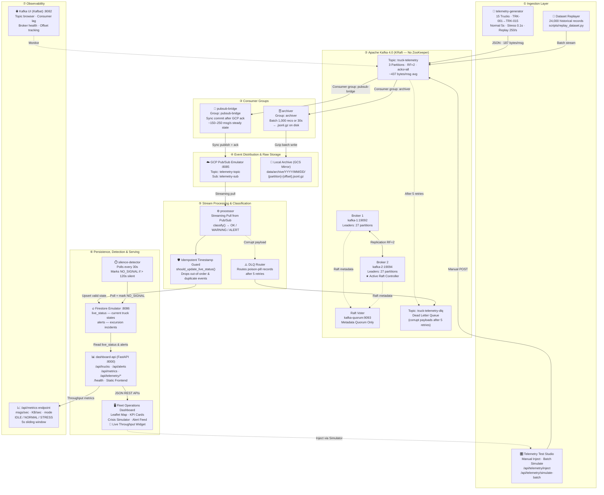
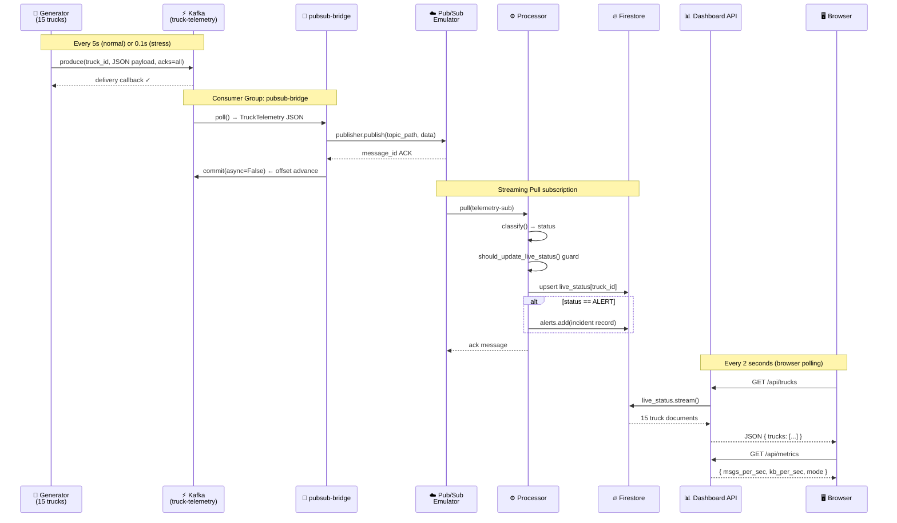
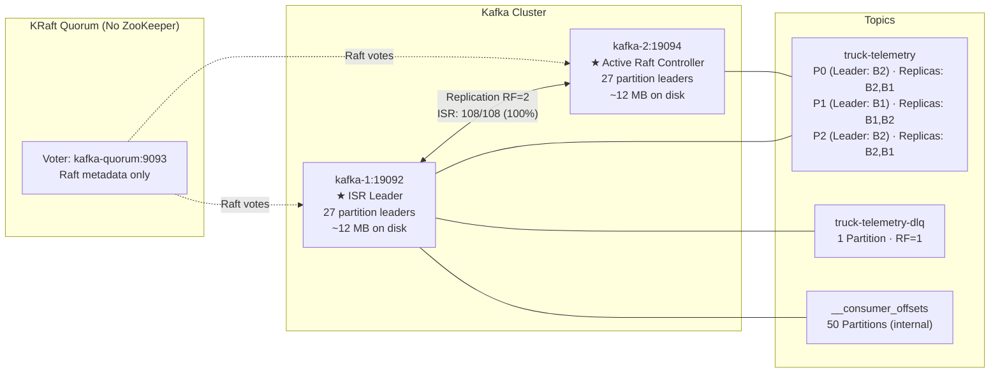
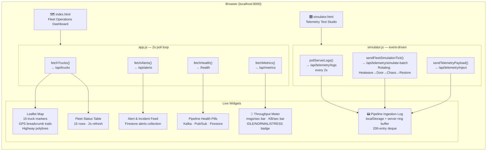

# 🏛️ ColdChain Fleet Architecture & End-to-End Data Flow

This document details the architectural design, event flow, decoupling mechanisms, and real-time observability metrics of the **ColdChain Fleet** MLOps and streaming data engineering platform.

---

## 1. High-Level System Architecture



---

## 2. Data Flow: Producer → Consumer (Detailed)



---

## 3. Throughput Modes & Measured Rates

| Mode | Command | msg/sec | KB/sec | Trigger |
|:---|:---|:---|:---|:---|
| **IDLE** | _(no injection)_ | 0 | 0 | No simulator activity |
| **NORMAL** | `make normal` | ~3 | ~0.7 | Generator at 5s interval |
| **NORMAL (UI burst)** | Click fleet buttons | 3–15 | 1–6 | Batch simulate via dashboard |
| **STRESS** | `make stress` | ~150–246 | ~65–105 | Generator at 0.1s interval |
| **REPLAY** | `make replay` | ~250 | ~106 | CSV dataset blast |

> **Live observation:** The **📡 Live Kafka Throughput** widget on the dashboard right panel shows real-time `msgs/sec`, `KB/sec`, progress bars, and a mode badge (`💤 IDLE` / `✅ NORMAL` / `⚡ STRESS`) updated every 2 seconds via `/api/metrics`.

---

## 4. Kafka Cluster Details



### Kafka Health Benchmarks

| Metric | Current Value | Meaning |
|:---|:---|:---|
| **Total Messages** | 9,937+ (and growing) | Confirmed pipeline ingestion at scale |
| **Kafka Log Size** | ~4.14 MB (×2 replicated = ~8 MB) | Avg 437 bytes/msg including headers |
| **Partitions** | 3 (P0, P1, P2) | Parallel consumption by truck_id hash |
| **Replication Factor** | 2 | Zero data loss if one broker crashes |
| **Under-Replicated Partitions** | **0** | Clean HA state |
| **DLQ Messages** | **0** | All payloads pass Pydantic schema validation |
| **Consumer Groups** | `pubsub-bridge`, `archiver` | Two independent downstream consumers |

---

## 5. Frontend Architecture



---

## 6. Microservice Component Responsibilities

| Service | Technology | Role & Resilience Pattern |
|:---|:---|:---|
| **`telemetry-generator`** | Python 3.12, Confluent-Kafka | Interpolates GPS positions along 15 real Indian highway routes. Supports `NORMAL` (5s), `STRESS` (0.1s), and env-controlled excursion probability. |
| **`kafka-1` / `kafka-2`** | Apache Kafka 4.0 (KRaft) | Distributed event log. RF=2 with 3 partitions. Raft quorum via `kafka-quorum`. No ZooKeeper. |
| **`kafka-quorum`** | Apache Kafka 4.0 (Raft Voter) | Dedicated metadata-only voter for KRaft leader election. Not a data broker. |
| **`pubsub-bridge`** | Python, Confluent-Kafka, Pub/Sub SDK | Reads Kafka, publishes to Pub/Sub. Commits offset **only after** Pub/Sub ACK — at-least-once guarantee. |
| **`processor`** | Python, Pub/Sub SDK, Firestore SDK | Classifies telemetry (OK/WARNING/ALERT), applies idempotent timestamp guard, upserts Firestore, routes DLQ on 5 retries. |
| **`archiver`** | Python, Confluent-Kafka, gzip | Raw data lake writer. Buffers 1,000 records or 30s, then flushes to `YYYY/MM/DD/{partition}-{offset}.jsonl.gz`. |
| **`silence-detector`** | Python, Firestore SDK | Heartbeat monitor. Polls `live_status` every 30s. Marks trucks `NO_SIGNAL` if last ping > 120s. |
| **`dashboard-api`** | FastAPI, Uvicorn | REST API hub. Serves `/api/trucks`, `/api/alerts`, `/api/metrics`, `/api/telemetry/*`, `/health`. Singleton Firestore client. In-memory 200-entry log deque. |
| **`kafka-ui`** | Kafbat (React) | Visual Kafka monitor at `:8082`. Shows topic offsets, consumer lag, broker health, partition leaders. |
| **Web Frontend** | HTML5, Vanilla CSS/JS, Leaflet | Two-page SPA: Fleet Dashboard + Telemetry Test Studio. localStorage log persistence, 2s server log polling, live throughput widget. |

---

## 7. Production GCP Migration Map

```
[Local Docker Service]              ──▶  [Google Cloud Managed Service]
────────────────────────────────────────────────────────────────────────────
telemetry-generator                 ──▶  IoT Core / Pub/Sub direct publish / Datastream
kafka-1 / kafka-2 (KRaft)           ──▶  Google Cloud Managed Kafka (Confluent) / GKE Kafka
kafka-quorum                        ──▶  (embedded in managed Kafka — no separate node)
pubsub-bridge                       ──▶  Kafka Connect Pub/Sub Sink Connector
Pub/Sub Emulator (:8085)            ──▶  Google Cloud Pub/Sub (telemetry-topic, telemetry-sub)
processor                           ──▶  Cloud Run (gen2, Eventarc Pub/Sub trigger)
Firestore Emulator (:8086)          ──▶  Cloud Firestore (Native mode, serverless)
archiver                            ──▶  Cloud Storage (GCS) + lifecycle Coldline/Archive rules
silence-detector                    ──▶  Cloud Scheduler (cron 1m) + Cloud Run Job
dashboard-api                       ──▶  Cloud Run (containerised FastAPI service)
kafka-ui (Kafbat)                   ──▶  Cloud Monitoring + Cloud Logging (Ops Agent)
Web Frontend                        ──▶  Firebase Hosting / Cloud CDN
/api/metrics endpoint               ──▶  Cloud Monitoring custom metrics + Grafana dashboard
```

---

## 8. Key Engineering Decisions

| Decision | Alternative Considered | Why This Choice |
|:---|:---|:---|
| **KRaft (no ZooKeeper)** | ZooKeeper-mode Kafka | Kafka 4.0 makes KRaft the only option; eliminates extra service dependency |
| **RF=2 across 2 brokers** | RF=1 (single copy) | Broker failover with zero data loss; tested with `make failover` |
| **Sync Pub/Sub commit** | Async batch commit | At-least-once delivery guarantee; Kafka absorbs lag spikes |
| **Firestore singleton client** | Per-request client | Prevents gRPC connection pool exhaustion under load |
| **localStorage + server deque** | Server-side only logs | Logs persist across browser page reloads; server ring buffer survives JS crashes |
| **5s sliding window for /api/metrics** | Cumulative average | Reflects *current* injection rate not lifetime average; resets correctly after Clear |
