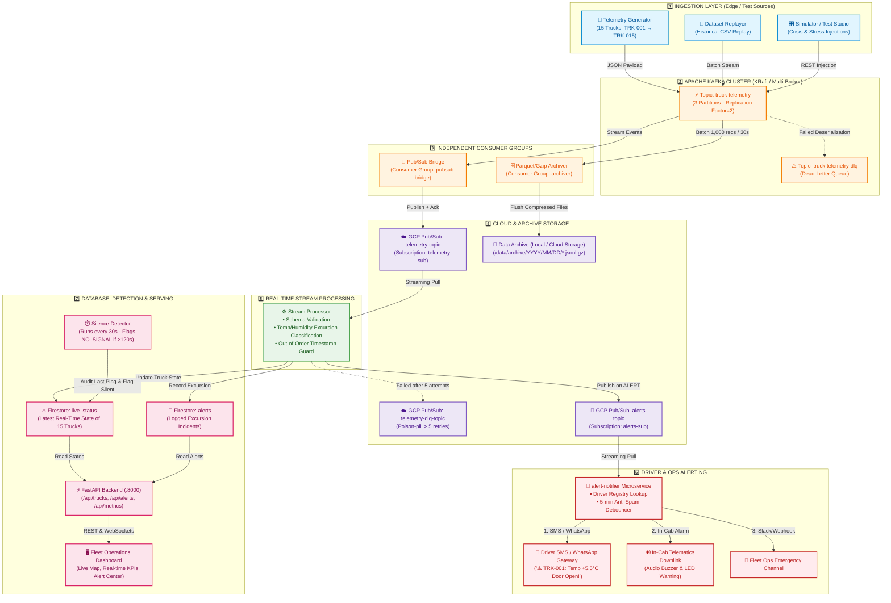
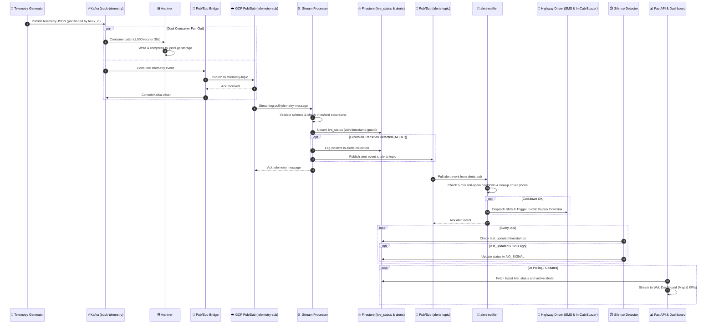

# 🔄 ColdChain Fleet Architecture & End-to-End Data Flow

This document outlines the end-to-end data flow, messaging architecture, streaming lifecycle, and component interactions in the **ColdChain Fleet** platform, including real-time driver & fleet alerting.

---

## 1. End-to-End System Architecture Diagram

---

## 2. Component & Layer Breakdown

### 1️⃣ Ingestion Layer
- **[telemetry-generator/generator.py](file:///home/user/Desktop/cold-chain-cloud/telemetry-generator/generator.py)**: Simulates 15 commercial refrigerated trucks traveling realistic highway routes across India. Emits temperature, humidity, GPS location, speed, fuel percentage, door status, and vibration levels.
- **[scripts/replay_dataset.py](file:///home/user/Desktop/cold-chain-cloud/scripts/replay_dataset.py)**: Streams historical CSV sensor datasets to Kafka at configurable rates (e.g., 250 msgs/sec) for benchmark testing.
- **Simulator & Test Studio**: Web-based injection interface in the dashboard for manual edge cases, cooling failures, and stress testing.

### 2️⃣ Message Ingestion & Buffer (Apache Kafka)
- **Topic `truck-telemetry`**: 3 partitions with a replication factor of 2. Acts as a decoupled buffer absorbing high write throughput.
- **Topic `truck-telemetry-dlq`**: Dead-letter queue for corrupt, unparseable, or schema-violating incoming payloads.

### 3️⃣ Decoupled Consumer Groups
- **[pubsub-bridge/bridge.py](file:///home/user/Desktop/cold-chain-cloud/pubsub-bridge/bridge.py)** (Consumer Group: `pubsub-bridge`): Continuously pulls messages from Kafka and securely publishes them to GCP Pub/Sub, committing Kafka offsets only upon successful cloud receipt.
- **[archiver/archiver.py](file:///home/user/Desktop/cold-chain-cloud/archiver/archiver.py)** (Consumer Group: `archiver`): Collects raw telemetry and batches 1,000 records or flushes every 30 seconds into gzip-compressed JSONL files for cold storage analytics without impacting the real-time processing path.

### 4️⃣ Cloud Ingestion (Google Cloud Pub/Sub)
- **Topic `telemetry-topic` & Subscription `telemetry-sub`**: Cloud messaging backbone for decoupled stream subscribers with an acknowledgment deadline of 20 seconds.
- **Topic `alerts-topic` & Subscription `alerts-sub`**: Dedicated event stream for incident excursions and driver dispatch events.
- **Dead-Letter Policy (`telemetry-dlq-topic`)**: Automatically routes messages that fail processing after 5 delivery attempts.

### 5️⃣ Stream Processing & Classification
- **[processor/processing.py](file:///home/user/Desktop/cold-chain-cloud/processor/processing.py)**:
  - **Schema Validation**: Validates payload structure and data types.
  - **Excursion Logic**: Evaluates temperature and humidity against safe cargo thresholds (`OK`, `WARNING`, `CRITICAL`).
  - **Timestamp Guard (`should_update_live_status`)**: Ensures only newer timestamps update the live truck state, preventing out-of-order or duplicate telemetry overwrites.
  - **Alert Publisher**: Publishes alert events to `alerts-topic` for decoupled multi-channel dispatch.

### 6️⃣ Driver & Fleet Alerting Service
- **[alert-notifier/notifier.py](file:///home/user/Desktop/cold-chain-cloud/alert-notifier/notifier.py)**:
  - Consumes from `alerts-sub`.
  - **Driver Directory Lookup**: Identifies driver name, contact phone, assigned route, and cargo sensitivity for the specific truck.
  - **Anti-Spam Debouncer**: Enforces a 5-minute cooldown per truck to avoid spamming the driver during a prolonged excursion.
  - **Multi-Channel Dispatch**: Simulates Driver SMS/WhatsApp dispatch, In-cab telematics buzzer downlink, and Fleet Ops channel notification.

### 7️⃣ State Storage, Detection & Serving
- **Firestore `live_status` Collection**: Retains the single latest state of each truck (location, health, status).
- **Firestore `alerts` Collection**: Time-series audit log capturing excursion events and resolution timestamps.
- **[silence-detector](file:///home/user/Desktop/cold-chain-cloud/silence-detector)**: Periodically audits the `live_status` collection every 30 seconds. Flags trucks as `NO_SIGNAL` if their last telemetry report exceeds 120 seconds.
- **FastAPI Backend (:8000)** & **Web Dashboard**: Exposes REST endpoints (`/api/trucks`, `/api/alerts`, `/api/metrics`) and renders an interactive operations map, live KPI cards, and an incident feed.

---

## 3. Detailed Sequence Diagram

